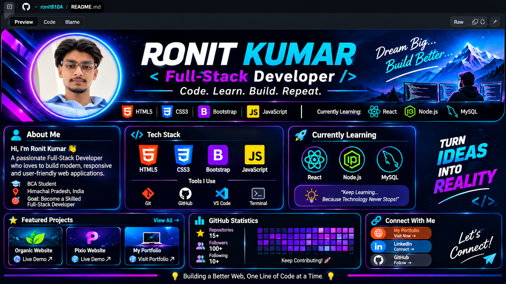

# 👋 Hi, I'm Ronit Kumar

### 💻 Full-Stack Developer

**Code. Learn. Build. Repeat.**

Building modern, responsive and user-friendly web experiences.

---

<!-- ================= ABOUT ME ================= -->

## 👨‍💻 About Me

- 🚀 Passionate Full-Stack Developer.
- 🎓 BCA Graduate.
- 🌍 Based in Himachal Pradesh, India.
- 💻 Interested in Web Development and UI Design.
- 🌱 Currently learning React.js, Node.js and MySQL.
- 🎯 Goal: Become a skilled Full-Stack Developer.

---

<!-- ================= TECH STACK ================= -->

## 🛠️ Tech Stack

### 🎨 Frontend Development

### 📚 Currently Learning

### ⚙️ Tools I Use

---

<!-- ================= LEARNING ================= -->

## 🚀 Currently Learning

| Technology | Focus |
|:---|:---|
| ⚛️ React.js | Components, Props, State, Hooks |
| 🟢 Node.js | Backend Development |
| 🐬 MySQL | Database Management |

---

<!-- ================= PROJECTS ================= -->

## ⭐ Featured Projects

<table>
<tr>
<td width="50%">
<h3 align="center">🌱 Organic Website</h3>

Responsive Organic Website

<a href="https://organic-eight-alpha.vercel.app/">Live Demo ↗</a>

</td>

<td width="50%">
<h3 align="center">💜 Pixio Website</h3>

Modern Fashion Website

<a href="https://pixio-virid.vercel.app/">Live Demo ↗</a>

</td>
</tr>
</table>

### 🌐 My Portfolio

---

<!-- ================= GITHUB STATS ================= -->

## 📊 GitHub Statistics

 

---

<!-- ================= CONNECT ================= -->

## 🌐 Connect With Me

---

### 💡 Code. Learn. Build. Repeat.

**Building a Better Web, One Line of Code at a Time.** 🚀

⭐ Thanks for visiting my GitHub Profile!

